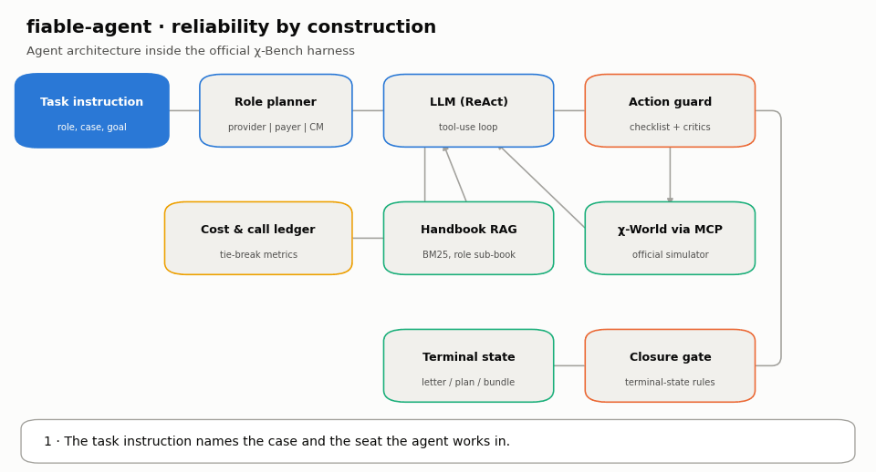
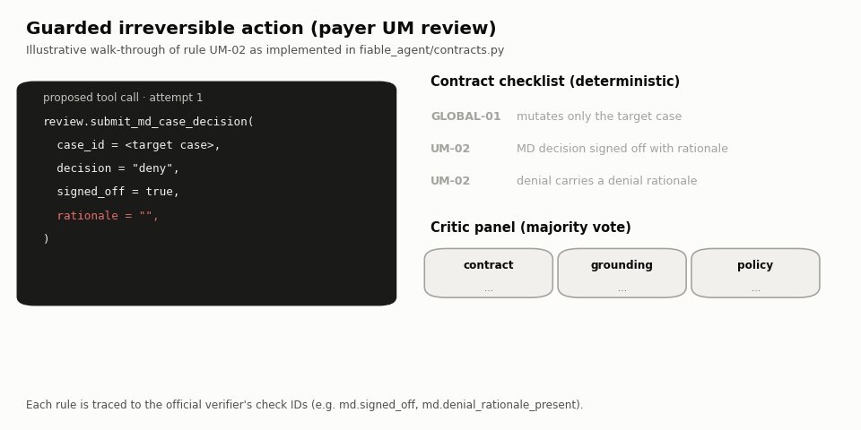
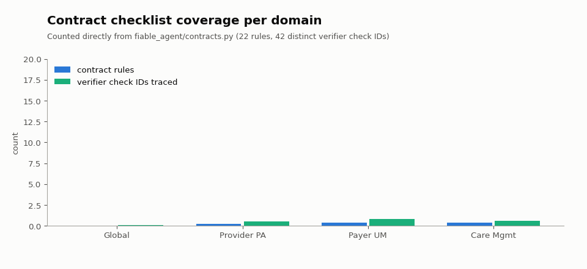
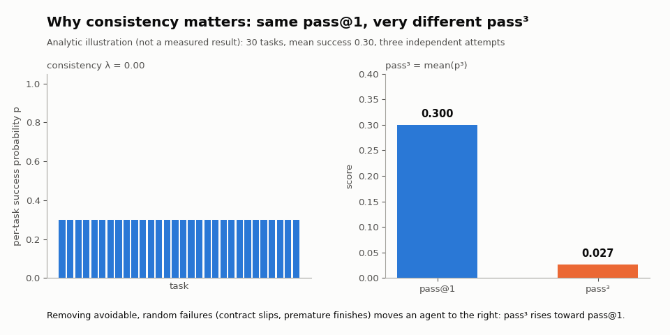

<div align="center">

# fiable-agent

### Reliability by construction for long-horizon healthcare agents on χ-Bench

*fiable* (Spanish): reliable, trustworthy.

[](LICENSE)
[](pyproject.toml)
[](tests)
[](https://github.com/actava-ai/chi-bench)
[](https://www.kaggle.com/competitions/chi-bench)



</div>

---

## Overview

**fiable-agent** is our entry to the [IEEE Big Data Cup 2026 — Challenge 07: χ-Bench](https://www.kaggle.com/competitions/chi-bench).
χ-Bench asks an autonomous agent to drive real-world U.S. healthcare-administration cases — provider prior
authorization, payer utilization management and population care management — to the correct terminal state inside
χ-World, a high-fidelity simulator of healthcare applications exposed as MCP tools and governed by a
1,279-document Managed-Care Operations Handbook.

The benchmark scores with a **strict binary verifier**: a trial earns 1 only when *every* required deterministic
contract check and every rubric-judged policy check passes. The organisers rank by **pass@1**, then by
**pass³** (all three independent attempts must pass), then by cost and tool calls.

That scoring rule shapes our whole design. In the χ-Bench paper the strongest agent reaches 28.0 % pass@1 and no
agent exceeds 20 % pass³ ([arXiv:2605.16679](https://arxiv.org/abs/2605.16679)). Many failures are not clinical
misjudgements but *avoidable workflow slips*: a decision submitted without its rationale, a case finished before
the letter is generated, a mutation on the wrong case. fiable-agent attacks exactly that class of failure.

> **Core idea.** Keep the strongest available agent untouched and make its irreversible actions *checkable before
> they happen*. Every mutating tool call passes through a deterministic contract checklist that is traced, rule by
> rule, to the official verifier's check identifiers; terminal calls are additionally reviewed by a three-judge
> critic panel; and the agent cannot stop while terminal obligations remain open.

## Highlights

- **Drop-in for the official harness.** The `fiable-cc` harness subclasses the official Claude Code harness used by
  the χ-Bench reference agents. The agent loop, tools, MCP wiring and trajectory format stay exactly as in the
  reference; reliability is added through Claude Code hooks.
- **22 contract rules → 42 verifier checks.** Each rule names the official check IDs it protects
  (e.g. `md.signed_off`, `md.denial_rationale_present`, `outcome.letter_types`).
- **Bounded guarding.** A blocked call returns a precise, fixable reason to the model; after a configurable number of
  blocks the action is released, so the guard can never stall a trial into a timeout.
- **Fail-open by design.** Any internal error in the guard allows the call and is logged; the guard can slow an agent
  down but never break a run.
- **Zero extra model calls in the default arms.** The checklist and the heuristic critic are deterministic, which
  keeps the cost and tool-call tie-breakers intact.
- **Credential-safe.** No secret ever enters a prompt, a config file or a log; YAML profiles containing secret-like
  values are rejected at load time.
- **Pre-registered ablation.** Every component is evaluated against the official baseline with three attempts per
  task under the official verifier (see [Evaluation protocol](docs/EVALUATION_PROTOCOL.md)).

## How the guard works



| Hook | Component | What it does |
|---|---|---|
| system prompt | **Role planner** | Detects the seat (provider, payer or care manager) and appends operating principles plus an ordered, role-specific workflow plan. |
| `PreToolUse` | **Contract checklist** | Runs the rules for the active role on every mutating or terminal MCP call; blocks with the rule ID and a fixable reason. |
| `PreToolUse` | **Critic panel** | On terminal calls, three judges vote: *contract* (deterministic), *grounding* (every identifier and code must appear in observed evidence) and *policy* (rationale must be specific). |
| `PostToolUse` | **Evidence ledger** | Records each call and its result; locks the target case after the first successful mutation (rule GLOBAL-01). |
| `Stop` | **Closure gate** | Refuses to finish while terminal-state obligations (dispositions, letters, finalized plans) are still open. |



## Why reliability pays twice

Final standings use pass@1 first and pass³ as the first tie-breaker. For the same pass@1, an agent whose failures
are *random* scores a far lower pass³ than one whose failures are *systematic*. Removing avoidable slips moves an
agent toward the consistent end, so the same engineering effort improves both the headline metric and the
reliability metric. The animation below is an analytic illustration of that effect, not a measured result.



## Results

Evaluation follows the pre-registered protocol in [docs/EVALUATION_PROTOCOL.md](docs/EVALUATION_PROTOCOL.md):
official control (stock Claude Code harness) versus three cumulative arms (`plan`, `checklist`, `critic`), same
model (`anthropic/claude-sonnet-5`), same per-task limits, three attempts per task, official verifier
(`claude-opus-4-7` judge). Results, with mean and spread across attempts, are published in
[results/](results/README.md) as soon as each run completes; every number there comes from the official verifier's
`scorecard.json` files.

| Arm | Components | pass@1 | pass³ | mean cost / trial | mean tool calls |
|---|---|---|---|---|---|
| C0 official | stock Claude Code harness | pending | pending | pending | pending |
| C1 plan | + principles and role plan | pending | pending | pending | pending |
| C2 checklist | + contract checklist and closure gate | pending | pending | pending | pending |
| C3 critic | + three-judge critic panel | pending | pending | pending | pending |

The final competition score is computed by the organisers on an unreleased private task set.

## Quick start

```bash
# 1. Unit tests (no network, no credentials)
pip install pyyaml pytest
python -m pytest -q                      # 71 tests

# 2. Install into a checkout of the official benchmark (pinned commit 7998d113)
git clone https://github.com/actava-ai/chi-bench && cd chi-bench && git checkout 7998d113
uv sync --extra dev
python ../fiable-agent/scripts/install_into_chi_bench.py --chi-bench . --apply
uv run cb agent list                     # lists fiable-cc and fiable-agent

# 3. Data (the Handbook is gated: request access on Hugging Face first)
uv run hf download actava/chi-bench --repo-type dataset --revision chi-bench-v1.0.0 --local-dir data/
echo chi-bench-v1.0.0 > data/.chi-bench-version
uv run hf download actava/managed-care-operations-handbook --repo-type dataset \
    --local-dir data/skills/managed-care-operations-handbook
uv run cb docker build && uv run cb data verify

# 4. Run an arm (credentials only in .env, never committed)
cp .env.example .env                     # ANTHROPIC_API_KEY or CLAUDE_CODE_OAUTH_TOKEN
python ../fiable-agent/experiments/generate_configs.py
uv run cb experiment run -f ../fiable-agent/experiments/configs/abl3_c2_checklist_um_x3.yaml
uv run python scripts/aggregate.py --trials-dir logs/experiments/abl3_c2_checklist_um_x3 \
    --prices configs/prices.yaml --out-csv logs/abl3_c2_checklist_um_x3.csv
```

Select an arm with `FIABLE_CC_ARM` (`stock`, `plan`, `checklist`, `critic`) in the experiment's `agent_env`.

## Repository layout

```
fiable_agent/          core package
  cc_guard.py          Claude Code hook entry point (pre / post / stop)
  contracts.py         22 contract rules traced to verifier check IDs
  critic.py            contract, grounding and policy judges; majority panel
  roles.py             role detection and role-specific workflow plans
  state.py             observed-evidence state and case lock
  agent.py, llm.py,    stand-alone ReAct loop on the Anthropic SDK (research arm)
  rag.py, ledger.py    BM25 handbook retrieval, cost and tool-call ledger
harness/
  fiable_cc_harness.py   official Claude Code harness + guard hooks (primary)
  fiable_agent_harness.py  harness for the stand-alone loop
scripts/install_into_chi_bench.py   registers both harnesses in a chi-bench checkout
experiments/           config generator, ablation configs, ledger summariser
tools/make_figures.py  regenerates every figure in this README
docs/                  evaluation protocol, compliance notes
tests/                 71 offline tests
```

## Compliance

- No Handbook content, task solutions, verifier-only files or credentials are stored in this repository
  (see [docs/COMPLIANCE.md](docs/COMPLIANCE.md)).
- Evaluated trials are fully autonomous; no human intervenes after a trial starts.
- All external code and data are credited below and used under their licenses.

## Credits and lineage

- **χ-Bench** benchmark, simulator, harnesses and verifier — actAVA.ai and the χ-Bench authors, Apache-2.0
  ([repository](https://github.com/actava-ai/chi-bench), [paper](https://arxiv.org/abs/2605.16679)). The
  `fiable-cc` harness subclasses Harbor's `ClaudeCode` harness as shipped with χ-Bench.
- **Managed-Care Operations Handbook** — actAVA.ai, gated, non-commercial research license; used locally, never
  redistributed.
- **BenchClaw** ([Agnuxo1/benchclaw](https://github.com/Agnuxo1/benchclaw)) — the multi-judge tribunal design
  that inspired the critic panel (conceptual lineage; no code copied).
- **EnigmAgent** ([Agnuxo1/EnigmAgent](https://github.com/Agnuxo1/EnigmAgent)) — the principle that a model must
  never see real secrets, applied here through environment-only credentials and secret-rejecting config loading
  (conceptual lineage; no code copied).
- Related work: τ²-bench ([arXiv:2506.07982](https://arxiv.org/abs/2506.07982)), HealthBench
  ([arXiv:2505.08775](https://arxiv.org/abs/2505.08775)).

## Citation

```bibtex
@software{angulo2026fiableagent,
  author  = {Angulo de Lafuente, Francisco},
  title   = {fiable-agent: Reliability by Construction for Long-Horizon Healthcare Agents on chi-Bench},
  year    = {2026},
  url     = {https://github.com/Agnuxo1/chi-bench-fiable-agent},
  note    = {IEEE Big Data Cup 2026, Challenge 07}
}
```

## Known limitations

As in any benchmark engineering work, a few points remain open and are tracked transparently:

- The guard's rules encode the verifier contracts we could derive from public code and documentation; private tasks
  may exercise workflows they do not cover, in which case the guard simply stays silent.
- The grounding judge compares identifiers as exact strings, so an equivalent code written in a different format
  may be flagged; the bounded block limit keeps such cases from stalling a trial.
- Care-management runs require a paid API key for the official patient simulator, so the development ablation
  focuses on prior authorization and utilization management unless that key is available.

## License

[Apache-2.0](LICENSE) © 2026 Francisco Angulo de Lafuente.
